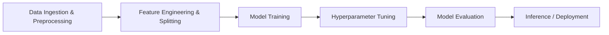

# 🚀 Belajar Machine Learning untuk Pemula

[](https://www.python.org/)
[](https://scikit-learn.org/)
[](https://www.tensorflow.org/)
[](https://pandas.pydata.org/)
[](LICENSE)

Repositori ini berisi kumpulan materi praktikum, modul latihan interaktif (*codelab*), implementasi algoritma, dan proyek *deep learning* yang mengacu pada kurikulum **Belajar Machine Learning untuk Pemula** (Dicoding Indonesia).

Repositori ini telah direfaktor agar memenuhi standar industri dan kaidah **Machine Learning Best Practices** (pencegahan *data leakage*, reproduksibilitas eksperimen, thresholding aktivasi probabilitas, dan kepatuhan standar kode **PEP 8**).

---

## 📌 Daftar Isi

1. [Gambaran Umum Proyek](#-gambaran-umum-proyek)
2. [Struktur Direktori Proyek](#-struktur-direktori-proyek)
3. [Katalog Modul & Codelab](#-katalog-modul--codelab)
4. [Penjelasan Teknis Tiap Modul](#-penjelasan-teknis-tiap-modul)
5. [Best Practices Machine Learning yang Diterapkan](#-best-practices-machine-learning-yang-diterapkan)
6. [Panduan Instalasi & Penggunaan](#-panduan-instalasi--penggunaan)
   - [Persiapan Lingkungan Lokal](#1-persiapan-lingkungan-lokal)
   - [Menjalankan Skrip Python](#2-menjalankan-skrip-python)
   - [Menjalankan Jupyter Notebook](#3-menjalankan-jupyter-notebook)
   - [Menjalankan di Google Colab](#4-menjalankan-di-google-colab)
7. [Dataset yang Digunakan](#-dataset-yang-digunakan)
8. [Lisensi & Kontribusi](#-lisensi--kontribusi)

---

## 📖 Gambaran Umum Proyek

Tujuan dari repositori ini adalah memberikan fondasi pemahaman konseptual dan implementatif mengenai alur kerja *end-to-end* dalam Machine Learning:



Cakupan materi meliputi:
- **Data Preprocessing & Feature Engineering**: Manipulasi dataframe, pemisahan data (*Train-Test Split* & *K-Fold Cross-Validation*), standarisasi fitur, dan reduksi dimensi (*PCA*).
- **Supervised Learning - Klasifikasi**: *Decision Tree*, *Logistic Regression*, dan *Support Vector Classifier (SVC)*.
- **Supervised Learning - Regresi**: *Linear Regression*, *Support Vector Regression (SVR)*, serta optimasi hyperparameter dengan *GridSearchCV*.
- **Unsupervised Learning**: *K-Means Clustering* dengan penentuan $k$ optimal melalui *Elbow Method*.
- **Deep Learning & Computer Vision**: Klasifikasi citra (*Binary Classification: Clean vs Messy Room*) menggunakan *Convolutional Neural Network (CNN)* berbasis TensorFlow/Keras dan teknik augmentasi gambar (*ImageDataGenerator*).

---

## 📂 Struktur Direktori Proyek

```text
Belajar-Machine-Learning-untuk-Pemula/
│
├── Codelab/                                  # Direktori utama notebook interaktif
│   ├── Decision Tree/                        # Klasifikasi spesies bunga Iris dengan Decision Tree
│   │   ├── Iris.csv                          # Dataset bunga Iris (Fisher, 1936)
│   │   ├── iris-tree.png                     # Visualisasi pohon keputusan yang diekspor
│   │   ├── iris_tree.dot                     # Representasi graf Graphviz model pohon
│   │   └── Latihan_SKLearn_Decision_Tree.ipynb
│   │
│   ├── Klasifikasi Gambar/                   # Deep Learning CNN (Messy vs Clean Room)
│   │   ├── file testing/                     # Sampel gambar untuk pengujian inferensi
│   │   │   ├── clean room.jpg
│   │   │   └── messy room.jpg
│   │   └── Latihan_Klasifikasi_Gambar.ipynb
│   │
│   ├── Linear Regression/                    # Regresi linier sederhana (Kamar vs Harga Rumah)
│   │   └── Latihan_SKLearn_Linear_Regression.ipynb
│   │
│   ├── Logistic Regression/                  # Klasifikasi keputusan pembelian iklan media sosial
│   │   ├── Social_Network_Ads.csv            # Dataset iklan jejaring sosial
│   │   └── Latihan_SKLearn_Logistic_Regression.ipynb
│   │
│   ├── SKLearn Grid Search/                  # Optimasi hyperparameter C dan gamma pada SVR
│   │   ├── Salary_Data.csv                   # Dataset pengalaman kerja vs gaji
│   │   └── Latihan_SKLearn_dengan_Teknik_Grid_Search.ipynb
│   │
│   ├── SKLearn K-means/                      # Segmentasi pelanggan mall tanpa label
│   │   ├── Mall_Customers.csv                # Dataset pelanggan mall
│   │   └── Latihan_SKLearn_K_means.ipynb
│   │
│   ├── SKLearn PCA/                          # Reduksi dimensionalitas Iris dataset
│   │   └── Latihan_SKLearn_PCA.ipynb
│   │
│   ├── SKLearn SVM/                          # Klasifikasi diabetes menggunakan Support Vector Machine
│   │   ├── diabetes.csv                      # Pima Indians Diabetes Dataset
│   │   └── SKLearn_SVM_untuk_Klasifikasi.ipynb
│   │
│   ├── SKLearn SVR/                          # Regresi non-linier menggunakan kernel RBF
│   │   ├── Salary_Data.csv                   # Dataset pengalaman kerja vs gaji
│   │   └── Latihan_SKLearn_SVR.ipynb
│   │
│   ├── Test Split/                           # Dasar pemisahan data latih & uji
│   │   └── Latihan_SKLearn_Train_Test_Split.ipynb
│   │
│   └── Validation Split/                     # K-Fold Cross Validation dengan Decision Tree
│       └── Latihan_SKLearn_Cross_Validation_Split.ipynb
│
├── splitting.py                              # Skrip utilitas modular untuk manipulasi kolom teks
├── requirements.txt                          # Spesifikasi pustaka dan dependensi proyek
├── .gitignore                                # File pengabaian Git untuk artefak & cache
└── README.md                                 # Dokumentasi komprehensif proyek
```

---

## 📊 Katalog Modul & Codelab

| No | Modul / Topik | Paradigma | Algoritma / Pustaka | Dataset | Google Colab |
|---|---|---|---|---|:---:|
| 1 | **Train-Test Split** | Dasar Evaluasi | `train_test_split` (scikit-learn) | Iris Dataset | [](https://colab.research.google.com/github/MHendriF/Belajar-Machine-Learning-untuk-Pemula/blob/main/Codelab/Test%20Split/Latihan_SKLearn_Train_Test_Split.ipynb) |
| 2 | **Cross Validation** | Validasi Model | `cross_val_score`, Decision Tree | Iris Dataset | [](https://colab.research.google.com/github/MHendriF/Belajar-Machine-Learning-untuk-Pemula/blob/main/Codelab/Validation%20Split/Latihan_SKLearn_Cross_Validation_Split.ipynb) |
| 3 | **Linear Regression** | Supervised (Regresi) | `LinearRegression` (OLS) | Dummy Housing Data | [](https://colab.research.google.com/github/MHendriF/Belajar-Machine-Learning-untuk-Pemula/blob/main/Codelab/Linear%20Regression/Latihan_SKLearn_Linear_Regression.ipynb) |
| 4 | **Logistic Regression** | Supervised (Klasifikasi) | `LogisticRegression`, `StandardScaler` | Social Network Ads | [](https://colab.research.google.com/github/MHendriF/Belajar-Machine-Learning-untuk-Pemula/blob/main/Codelab/Logistic%20Regression/Latihan_SKLearn_Logistic_Regression.ipynb) |
| 5 | **Decision Tree** | Supervised (Klasifikasi) | `DecisionTreeClassifier`, `export_graphviz` | Iris Dataset | [](https://colab.research.google.com/github/MHendriF/Belajar-Machine-Learning-untuk-Pemula/blob/main/Codelab/Decision%20Tree/Latihan_SKLearn_Decision_Tree.ipynb) |
| 6 | **SVM Klasifikasi** | Supervised (Klasifikasi) | `SVC` (Support Vector Classifier) | Pima Indians Diabetes | [](https://colab.research.google.com/github/MHendriF/Belajar-Machine-Learning-untuk-Pemula/blob/main/Codelab/SKLearn%20SVM/SKLearn_SVM_untuk_Klasifikasi.ipynb) |
| 7 | **SVR (Regresi)** | Supervised (Regresi) | `SVR` (RBF Kernel) | Salary Data | [](https://colab.research.google.com/github/MHendriF/Belajar-Machine-Learning-untuk-Pemula/blob/main/Codelab/SKLearn%20SVR/Latihan_SKLearn_SVR.ipynb) |
| 8 | **Grid Search Tuning** | Optimasi Model | `GridSearchCV`, `SVR` | Salary Data | [](https://colab.research.google.com/github/MHendriF/Belajar-Machine-Learning-untuk-Pemula/blob/main/Codelab/SKLearn%20Grid%20Search/Latihan_SKLearn_dengan_Teknik_Grid_Search.ipynb) |
| 9 | **K-Means Clustering** | Unsupervised (Klastering) | `KMeans`, Elbow Method | Mall Customers Data | [](https://colab.research.google.com/github/MHendriF/Belajar-Machine-Learning-untuk-Pemula/blob/main/Codelab/SKLearn%20K-means/Latihan_SKLearn_K_means.ipynb) |
| 10 | **PCA Dimensionality** | Unsupervised (Reduksi Dimensi) | `PCA` (Principal Component Analysis) | Iris Dataset | [](https://colab.research.google.com/github/MHendriF/Belajar-Machine-Learning-untuk-Pemula/blob/main/Codelab/SKLearn%20PCA/Latihan_SKLearn_PCA.ipynb) |
| 11 | **Klasifikasi Gambar (CNN)** | Deep Learning (Computer Vision) | `Conv2D`, `MaxPooling2D`, `ImageDataGenerator` | Messy vs Clean Room | [](https://colab.research.google.com/github/MHendriF/Belajar-Machine-Learning-untuk-Pemula/blob/main/Codelab/Klasifikasi%20Gambar/Latihan_Klasifikasi_Gambar.ipynb) |

---

## 🔍 Penjelasan Teknis Tiap Modul

### 1. Data Splitting Utility (`splitting.py`)
- **Tujuan**: Memisahkan entitas teks nama lengkap (*Full Name*) menjadi *First Name* dan *Last Name* pada pandas DataFrame.
- **Implementasi**: Dilengkapi penanganan nama lebih dari 2 kata (`n=1`), type hinting, dokumentasi docstring, dan guard `if __name__ == '__main__':`.

### 2. Train-Test Split (`Test Split`)
- **Tujuan**: Mencegah *overfitting* dengan membagi data menjadi subset data latih (80%) dan data uji (20%).
- **Konsep Kunci**: Parameter `random_state` digunakan untuk memastikan partisi data bersifat deterministik dan dapat direproduksi (*reproducible*).

### 3. K-Fold Cross Validation (`Validation Split`)
- **Tujuan**: Mengurangi bias pembagian data tunggal dengan melakukan $k=5$ iterasi pengujian silang (*cross validation*).
- **Hasil**: Menghasilkan metrik performa rata-rata yang lebih representatif terhadap variasi data baru.

### 4. Linear Regression (`Linear Regression`)
- **Tujuan**: Memodelkan hubungan linier antara variabel independen (jumlah kamar tidur) terhadap variabel dependen (harga rumah).
- **Fungsi**: $y = \beta_0 + \beta_1 x$, diminimalkan dengan metode *Ordinary Least Squares (OLS)*.

### 5. Logistic Regression (`Logistic Regression`)
- **Tujuan**: Memprediksi probabilitas biner apakah calon pembeli akan membeli produk berdasarkan umur dan estimasi gaji.
- **Alur Kerja**: One-hot encoding untuk fitur kategorikal gender $\rightarrow$ Train-test split $\rightarrow$ Feature scaling (`StandardScaler`) $\rightarrow$ Pelatihan model logistik.

### 6. Decision Tree Classification (`Decision Tree`)
- **Tujuan**: Mengklasifikasikan 3 spesies bunga Iris (*Setosa, Versicolor, Virginica*) berdasarkan dimensi sepal dan petal.
- **Output**: Visualisasi percabangan pohon keputusan menggunakan Graphviz (`.dot` & `.png`).

### 7. Support Vector Machine / SVM (`SKLearn SVM`)
- **Tujuan**: Klasifikasi biner untuk mendeteksi onset diabetes pada dataset Pima Indians.
- **Konsep Kunci**: Menemukan *hyperplane* optimal dengan margin terbesar untuk memisahkan kedua kelas.

### 8. Support Vector Regression / SVR (`SKLearn SVR`)
- **Tujuan**: Melakukan regresi non-linier antara lama pengalaman kerja (*Years of Experience*) terhadap besaran gaji (*Salary*).
- **Kernel**: Menggunakan kernel *Radial Basis Function (RBF)* untuk memetakan data ke ruang berdimensi lebih tinggi.

### 9. Hyperparameter Tuning dengan Grid Search (`SKLearn Grid Search`)
- **Tujuan**: Menemukan kombinasi hyperparameter terbaik secara otomatis untuk model SVR.
- **Ruang Pencarian**: Menguji variasi nilai penalti $C \in \{1000, 10000, 100000\}$ dan koefisien kernel $\gamma \in \{0.5, 0.05, 0.005\}$.

### 10. K-Means Clustering & Elbow Method (`SKLearn K-means`)
- **Tujuan**: Mengelompokkan pelanggan mall ke dalam segmen-segmen homogen berdasarkan pendapatan tahunan dan skor pengeluaran tanpa label supervisi.
- **Elbow Method**: Menghitung metrik *Inertia* (Within-Cluster Sum of Squares) dari $k=1$ hingga $k=10$ untuk menemukan titik infleksi (*elbow*) pada $k=5$.

### 11. Principal Component Analysis / PCA (`SKLearn PCA`)
- **Tujuan**: Mereduksi dimensi fitur Iris dari 4 dimensi menjadi 2 *principal components* tanpa kehilangan variansi informasi yang signifikan.
- **Evaluasi**: Membandingkan performa model Decision Tree sebelum dan sesudah reduksi dimensi.

### 12. Convolutional Neural Network / CNN (`Klasifikasi Gambar`)
- **Tujuan**: Klasifikasi citra biner kamar rapi (*clean room*) vs kamar berantakan (*messy room*).
- **Arsitektur Model**:
  - $4 \times$ Blok Konvolusi: `Conv2D(32/64/128/512, (3,3), relu)` diikuti oleh `MaxPooling2D(2,2)`.
  - Layer Klasifikasi: `Flatten()` $\rightarrow$ `Dense(512, relu)` $\rightarrow$ `Dense(1, sigmoid)`.
- **Augmentasi Data**: Rotasi gambar (`rotation_range=20`), pembalikan horizontal (`horizontal_flip=True`), dan shear transformation (`shear_range=0.2`) menggunakan `ImageDataGenerator`.

---

## 🛡️ Best Practices Machine Learning yang Diterapkan

Dalam pembaruan repositori ini, serangkaian perbaikan standar mutu telah diimplementasikan:

### 1. Pencegahan Data Leakage (Kebocoran Data)
> [!IMPORTANT]
> **Anti-Pattern Umum:** Melakukan `fit_transform()` pada seluruh dataset sebelum pembagian *train-test split*, atau memanggil `fit_transform()` pada data pengujian (*test set*).

- **Perbaikan pada StandardScaler (`Logistic Regression` & `SKLearn SVM`)**:
  Dataset dipisahkan terlebih dahulu menggunakan `train_test_split()`. Parameter statistik ($\mu, \sigma$) hanya dihitung dari data latih (`scaler.fit_transform(X_train)`), kemudian data uji ditransformasikan menggunakan parameter tersebut (`scaler.transform(X_test)`).
- **Perbaikan pada PCA (`SKLearn PCA`)**:
  Model PCA di-`fit` hanya pada `X_train`. Untuk data uji, transformasi dilakukan dengan `pca.transform(X_test)` sehingga distribusi data uji tidak mencemari komponen utama.

### 2. Thresholding Probabilitas yang Benar pada Model Klasifikasi Citra
- Layer output menggunakan fungsi aktivasi `sigmoid`, yang menghasilkan nilai probabilitas kontinu $[0.0, 1.0]$.
- Kode pengujian diperbaiki dari perbandingan mutlak `if classes == 0:` menjadi ambang batas probabilitas yang tepat:
  ```python
  if score < 0.5:
      print("Hasil Prediksi: CLEAN")
  else:
      print("Hasil Prediksi: MESSY")
  ```

### 3. Reproduksibilitas Eksperimen (Reproducibility)
- Menambahkan parameter `random_state=42` pada algoritma berbasis stokastik (`KMeans`, `DecisionTreeClassifier`, `train_test_split`).
- Menentukan parameter eksplisit `n_init=10` pada `KMeans` guna menghilangkan *FutureWarning* pada rilis scikit-learn terbaru.

### 4. Standar Kode Bersih (PEP 8 & Modularity)
- Skrip `splitting.py` direstrukturisasi dengan menerapkan fungsi murni (*pure function*), type hints (`df: pd.DataFrame`), docstrings standar Google/Numpy format, serta guard `if __name__ == '__main__':`.
- Penghapusan penggunaan `inplace=True` yang berpotensi menimbulkan inkonsistensi pada versi pandas masa depan.

---

## 💻 Panduan Instalasi & Penggunaan

### 1. Persiapan Lingkungan Lokal

Disarankan menggunakan Python versi **3.10**, **3.11**, atau **3.12**.

```bash
# 1. Clone repositori ke komputer lokal
git clone https://github.com/MHendriF/Belajar-Machine-Learning-untuk-Pemula.git
cd Belajar-Machine-Learning-untuk-Pemula

# 2. Buat lingkungan virtual (virtual environment)
python -m venv venv

# 3. Aktifkan lingkungan virtual
# Pada Windows (PowerShell):
.\venv\Scripts\Activate.ps1
# Pada Windows (CMD):
.\venv\Scripts\activate.bat
# Pada Linux / macOS:
source venv/bin/activate

# 4. Install seluruh dependensi pustaka
pip install --upgrade pip
pip install -r requirements.txt
```

### 2. Menjalankan Skrip Python

Jalankan skrip pemisahan nama pengembang:
```bash
python splitting.py
```

### 3. Menjalankan Jupyter Notebook

Untuk menjalankan dan bereksplorasi dengan codelab di komputer lokal:
```bash
jupyter notebook
```
Buka browser dan navigasikan ke folder `Codelab/`, lalu pilih modul yang ingin dipelajari.

### 4. Menjalankan di Google Colab

Setiap notebook telah dilengkapi lencana interaktif **Open In Colab**. Anda cukup menekan tombol lencana di tabel katalog atau langsung pada bagian atas notebook di GitHub untuk membukanya secara instan tanpa perlu instalasi lokal.

---

## 📁 Dataset yang Digunakan

| Dataset | Deskripsi | Asal / Sumber |
|---|---|---|
| **Iris Dataset** | 150 sampel pengukuran morfologi 3 spesies bunga Iris | Scikit-Learn Built-in & Fisher (1936) |
| **Social Network Ads** | Data demografi pengguna (umur, gaji) dan keputusan pembelian | Kaggle / Dicoding Academy |
| **Salary Data** | Hubungan lama tahun pengalaman kerja terhadap pendapatan tahunan | Kaggle / Dicoding Academy |
| **Mall Customers** | Data segmentasi konsumen berdasarkan skor pengeluaran belanja | Kaggle / Unsupervised Learning Benchmark |
| **Pima Indians Diabetes** | Data diagnostik medis wanita suku Pima untuk prediksi diabetes | National Institute of Diabetes and Digestive and Kidney Diseases (NIDDK) |
| **Messy vs Clean Room** | Dataset citra kamar tidur kondisi rapi dan berantakan | Dicoding Academy Asset Repository |

---

## 📜 Lisensi & Kontribusi

Proyek ini dirilis di bawah lisensi [MIT License](LICENSE). Repositori ini ditujukan untuk kebutuhan edukasi, riset, dan referensi implementasi Machine Learning bagi pemula.

Jika Anda menemukan kendala atau ingin menyempurnakan implementasi kode, silakan buka *Issue* atau kirimkan *Pull Request*.

---
*Dikelola dengan ❤️ untuk pembelajaran Machine Learning Indonesia.*
